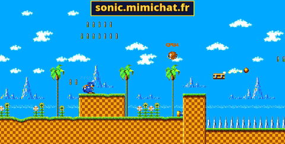

# Sonic PHP

[English](README.md) · **Français**

Un remake fan de **Sonic the Hedgehog (Master System)**, écrit entièrement en PHP : environ 21 000 lignes, à 60 i/s
en natif sur ordinateur (PHP + SDL2) et **dans le navigateur** (PHP compilé en WebAssembly), sur PC et mobile, avec
un **multijoueur en ligne jusqu'à 6 joueurs**.

**▶ Jouer : https://sonic.mimichat.fr**



## Fonctionnalités

- **Seul** : les zones du jeu d'origine, les meilleurs temps, et un fantôme de son record à battre.
- **Multijoueur en ligne** jusqu'à 6, dans le navigateur ou sur ordinateur :
  - 4 modes : **course**, **drapeau**, **anneaux**, **deathmatch** ;
  - les actes 1 et 2 des six zones (Green Hill, Bridge, Jungle, Labyrinth, Scrap Brain, Sky Base) et les huit
    niveaux bonus ;
  - salons publics, ou privés avec un code de 4 lettres ; les places libres sont prises par des bots ;
  - discussion dans les menus du salon et en jeu (T ou Entrée).
- **Versus local** contre des bots.
- **Replays** de chaque partie, meilleurs temps et fantômes sauvegardés.
- **PC et mobile** : clavier, ou commandes tactiles sur téléphone.
- Options d'affichage : filtre CRT, vitesse PAL / NTSC.

## Commandes

| | |
|---|---|
| ← → | courir |
| ↓ | boule |
| Espace | sauter |
| T / Entrée | discuter (en ligne) |
| Échap | quitter |

Sur téléphone : le pad en bas à gauche (ou glisser n'importe où) pour courir, toucher ou bouton A pour sauter.

## Lancer en natif (ordinateur)

Il faut PHP 8.2 ou plus avec les extensions SDL2 (`sdl`, `sdl_image`, `sdl_ttf`, `sdl_mixer`), et Composer.

```bash
git clone --recurse-submodules https://github.com/davidnurdin/sonicGamePhp.git
cd sonicGamePhp

# bibliothèques SDL2 (Debian / Ubuntu)
sudo apt install libsdl2-dev libsdl2-image-dev libsdl2-ttf-dev libsdl2-mixer-dev php-dev

# extensions PHP, depuis les sous-modules
for ext in php-sdl php-sdl-image php-sdl-ttf php-mixer; do
    (cd $ext && phpize && ./configure && make && sudo make install)
done

composer install
./start.sh
```

- `SONIC_PHP=php8.3 ./start.sh` : un autre PHP (par défaut `php8.2`).
- `SONIC_NET_URL=ws://localhost:8090/ws ./start.sh` : un autre serveur pour le multijoueur (par défaut
  `wss://sonic.mimichat.fr/ws`).

La version ordinateur rejoint les mêmes salons en ligne que les navigateurs.

## Comment ça marche

### Le jeu

- Du PHP, organisé avec des composants Symfony (DependencyInjection, Console, Config, Yaml).
- La boucle de jeu est une boucle d'événements **ReactPHP** (`src/Loop`, `src/Game.php`).
- L'affichage, le son et les commandes passent par **SDL2**, via des extensions PHP
  ([php-sdl](https://github.com/Ponup/php-sdl), [php-sdl-image](https://github.com/kea/php-sdl-image),
  [php-sdl-ttf](https://github.com/Ponup/php-sdl-ttf), [php-sdl-mixer](https://github.com/kea/php-sdl-mixer)).
- Les niveaux, tiles, collisions et objets sont dans `assets/levels` ; les graphismes dans `assets/tileset` ; le son
  dans `assets/mixer`.
- Les scripts de `tools/` décodent les données de la ROM d'origine : graphismes des niveaux et cycles de palette,
  sprites des objets, et les musiques et bruitages, rendus en faisant tourner le driver son Z80 d'origine sur un
  émulateur et en capturant la sortie de sa puce SN76489 (PSG).

```
src/
  Game.php          le jeu
  Loop/             boucle de jeu ReactPHP
  Scene/            scène, caméra, HUD, tilesets, écrans, lecteur de replays
  Entities/         joueur, ennemis, objets, physique
  Level/            niveaux
  Multiplayer/      versus, bots, en ligne (Online.php, VersusNetwork.php)
  Renderer/         fenêtre SDL, rendu, texte, filtre CRT
  InputManager/     clavier et pad tactile
  SoundManager/     musiques et bruitages
  Save/             options, meilleurs temps, fantômes, replays, statistiques
```

### Dans le navigateur

La version navigateur est construite par [php-wasm-sdl](https://github.com/davidnurdin/php-wasm-sdl) : PHP 8.3
compilé en WebAssembly avec Emscripten, avec l'extension SDL2. Une fine couche en C fait **un tour de la boucle
ReactPHP à chaque `requestAnimationFrame`**, et PHP n'est jamais arrêté entre deux images : tout le jeu reste en
mémoire. SDL2 dessine en WebGL, joue le son par Web Audio, et les sauvegardes vont dans IndexedDB.

Explication détaillée : [le fonctionnement du moteur et du jeu](https://github.com/davidnurdin/php-wasm-sdl/blob/main/doc/fonctionnement.md).

### Multijoueur en ligne

Le réseau, c'est [php-wasm-network](https://github.com/davidnurdin/php-wasm-network), avec la même API PHP dans le
navigateur et en natif.

- **L'hôte fait l'arbitre** : son jeu fait tourner les règles du match (contacts, drapeau, anneaux, arrivée, chrono,
  scores) et les bots. Il n'y a pas de serveur de jeu.
- Chaque joueur **pilote son propre Sonic sur sa machine** : aucun retard sur ses commandes, même avec un ping élevé.
- Les joueurs envoient leur état 30 fois par seconde, l'hôte un instantané du match 20 fois par seconde (messages non
  fiables) ; les événements comme un coup ou un moniteur cassé sont fiables.
- Les autres Sonic sont affichés **120 ms dans le passé, interpolés**, et l'hôte fait de la **compensation de
  latence**.
- Les navigateurs se parlent en **WebRTC** ; un relais écrit en PHP gère les salons et la signalisation, avec un
  serveur TURN pour les réseaux stricts. La version native passe toujours par le relais.

Explication complète : [le multijoueur en ligne, expliqué](https://github.com/davidnurdin/php-wasm-sdl/blob/main/doc/multijoueur-en-ligne.md).

## Projets liés

- [php-wasm-sdl](https://github.com/davidnurdin/php-wasm-sdl) : PHP + SDL en WebAssembly, la version navigateur.
- [php-wasm-network](https://github.com/davidnurdin/php-wasm-network) : le réseau pour PHP (WebSocket + WebRTC),
  serveur de salons, relais et signalisation.
- [sonicGameSite](https://github.com/davidnurdin/sonicGameSite) : le site (salons, statistiques, replays, éditeurs).
- Article (en anglais) : [Running a 21k-line PHP game at 60 fps in the browser with WebAssembly](https://dev.to/mimi_chat_b3bf7a39a962a82/running-a-21k-line-php-game-at-60-fps-in-the-browser-with-webassembly-2cd3).

## Avertissement

Sonic PHP est un projet de fan, gratuit et non commercial. Sonic the Hedgehog, ses personnages, ses graphismes et
ses musiques appartiennent à SEGA. Ce projet n'est ni affilié à SEGA ni approuvé par SEGA.
